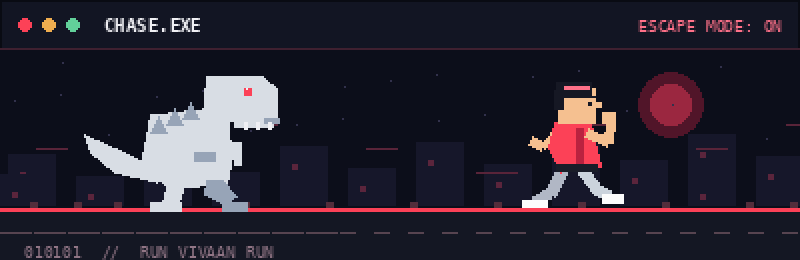
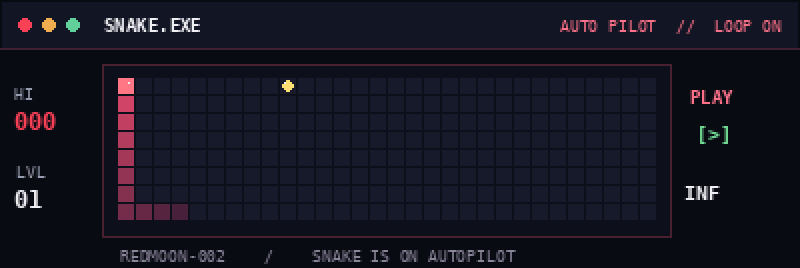

<!--
  VIVAAN KHAJURIA — GITHUB PROFILE README
  Theme: Midnight / Crimson
  Profile repo: https://github.com/RedMoon-002/RedMoon-002
  Uses GitHub-safe HTML + Markdown, local animated GIFs, and a scheduled snake SVG.
-->
      

  
    RUN_VIVAAN_RUN.exe — The Chrome Dino has entered the chat.
  
<b>Computer Science student · AI/ML enthusiast · Developer · Curious creator</b>

  
📍 Jammu, India &nbsp; • &nbsp; 🎓 MIET Jammu &nbsp; • &nbsp; 🚀 Always building something new
  
  
🩸 About Me // Player Profile
class VivaanKhajuria:
    education = "B.Tech CSE — AI/ML | MIET Jammu"
    location = "Jammu, India"
    interests = ["Artificial Intelligence", "Automation", "Game Development"]
    languages = ["Python", "C", "Dart", "GDScript"]

    def current_mission(self):
        return "Keep learning. Build useful things. Turn ideas into code."
I'm Vivaan Khajuria, a Computer Science undergraduate specializing in Artificial Intelligence and Machine Learning at Model Institute of Engineering & Technology (MIET), Jammu. I enjoy experimenting with code, learning how systems work, and bringing ideas to life — from automation scripts and Android apps to games and AI-based projects.
- 🧠 Exploring machine learning, algorithms, and practical AI applications
- 🐍 Writing programs in Python and C
- 📱 Experimenting with Flutter and Android development
- 🤖 Building automation workflows with UiPath
- 🎮 Learning game development with Godot / GDScript
- 🐧 Practicing Linux, shell scripting, and developer tools
🎓 Education
Journey	Institution	Details
🎓 Bachelor of Technology	Model Institute of Engineering & Technology (MIET), Jammu	Computer Science & Engineering — AI/ML specialization · Pursuing
📚 Class XII	St. Xavier Convent School, Barnai, Jammu	Completed higher secondary education

⚡ Skills Unlocked // Tech Stack

  

  
  
  

🛠️ Missions Completed & In Progress
Project	What it's about	Status
🌐 Personal Portfolio	My personal space on the web, built to showcase my work and interests	Public repository
🐧 Linux Commands	Linux commands and shell practice from my learning journey	Public repository
💻 C Programs	C language exercises and programming practice	Public repository
🎵 TrackBox	Flutter-based Android music app experiment with playlists and audio handling	Work in progress
🛣️ Pothole Detection System	Exploring computer vision for detecting road-surface damage	Work in progress

🏆 Achievements Unlocked
- 🥇 District-level gold medal in speedball
- 🏆 Three academic trophies
- 🌱 Constantly expanding my technical skills through coursework and personal projects
🐍 Snake Arcade — Always Running

  
   
  🎮 Arcade snake runs automatically — no clicks or installs needed.

🩸 My GitHub Contributions, Eaten by a Snake

  

The contribution snake is updated daily by <code>.github/workflows/snake.yml</code>. Run the workflow once manually after uploading this profile to replace its initial placeholder. Both snakes are animations, not playable games — GitHub README files do not run JavaScript.
📊 GitHub Activity

  
  

GitHub statistics are generated by an external service and may occasionally be unavailable because of rate limits.
🌙 Beyond the Code
I also enjoy video games, making small games, reading, writing, travel, and researching new things. I like projects that mix creativity with problem-solving.

🚀 Let's Connect & Create

<i>"The best way to learn is to build something that didn't exist yesterday."</i>

